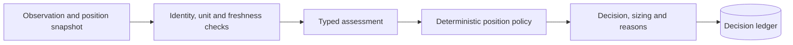

# Market Decision Engine

**Typed market observations, explainable position rules and replayable decisions.**

   [](LICENSE)

[Overview](#overview) · [Quickstart](#quickstart) · [Example](#example) · [Validation](#validation) · [Documentation](#documentation)

## Overview

A Python pipeline that combines evidence-linked market observations with account/position state and configurable policy. It records why a decision was produced, which inputs and model answers were used, and when the proposal expires. The application integrating the package owns execution and position updates.

**Stack:** Python · typed contracts · SQLite · JSONL · configurable policies · local inference adapter

## Position decisions

| Component | Behavior |
| --- | --- |
| SKIP | Inputs, coverage or policy checks do not permit a proposed entry/action. |
| BUY | A new position passes the applicable entry, exposure and evidence requirements. |
| HOLD / HOLD_BAG | Keep an existing position or its permitted residual allocation. |
| PROFIT / TP / SL | Propose partial reduction or exit under configured thresholds; no settlement is implied. |

## Processing path



## Quickstart

```console
python -m venv .venv
# Activate .venv, then:
python -m pip install -e .
omnia-trading --catalog
omnia-trading --strategy-policy
python -m unittest discover -s tests -v
```

The package retains its original omnia-trading command names. Catalog/policy inspection does not load a model. Tests use historical records and controlled backends. New native inference requires the optional local runtime and an explicitly selected checkpoint revision.

## Example

**Inspect the included capture window offline**

The historical casebook is distributed as a ZIP, keeping generated reports out of the root tree. From the repository root:

```console
python -m zipfile -e examples/market-window-2026-09-28.zip .local-casebook
omnia-trading-casebook verify .local-casebook
```

Verification checks archived records; it performs no new capture or model inference. [Strategy input](examples/strategy.jsonl) contains observation, context and policy. [Partial coverage](examples/strategy-partial.jsonl) demonstrates supplied-field handling. A decision label does not represent a placed order or realized return.

## Configuration and storage

Source values retain units, timestamps, time windows and evidence references. Missing coverage remains missing. The [strategy contract](src/omnia_trading/strategy_contracts.py) validates exposure limits and ratios; deterministic checks constrain model-derived answers. Configure the ledger and local inference runtime through [.env.example](.env.example).

## Repository guide

| Location | Responsibility |
| --- | --- |
| [src/omnia_trading/strategy.py](src/omnia_trading/strategy.py) | Position policy and decision processing |
| [src/omnia_trading/strategy_contracts.py](src/omnia_trading/strategy_contracts.py) | Account/position contracts and policy defaults |
| [src/omnia_trading/decision_notes.py](src/omnia_trading/decision_notes.py) | Evidence-linked explanations |
| [src/omnia_trading/casebook.py](src/omnia_trading/casebook.py) | Capture-window export and verification |
| [examples](examples) | JSONL input and archived casebook |

## Validation

These checks use offline fixtures or controlled backends.

## Scope and operational boundaries

This package proposes decisions and sizing. Execution authorization, wallet signing, fills and settlement belong to the integrating application. Historical captures and arithmetic policy timelines are not new trading results or model-quality benchmarks. Original Apache-2.0 attribution is retained.

## Documentation

- [Policy precedence and lifecycle](docs/STRATEGY.md)
- [Reason codes and interpretation](docs/DECISION_REASONS.md)
- [Parameter types and units](docs/PARAMETERS.md)
- [Python and CLI interfaces](docs/API.md)
- [Validation scope](docs/VALIDATION.md)

## License and attribution

See [LICENSE](LICENSE), [THIRD_PARTY_NOTICES.md](THIRD_PARTY_NOTICES.md).
