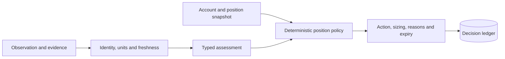

# Market Decision Engine

   [](LICENSE)

Combine a market observation with account/position context and produce a typed, explainable position decision that can be replayed from retained evidence.

The package separates assessment from deterministic position policy. Its output can propose sizing and an action; the integrating application still owns authorization, execution, position updates and settlement.

## Position lifecycle

| Decision | Interpretation |
| --- | --- |
| `SKIP` | Input coverage or policy does not permit the proposed action. |
| `BUY` | Entry and exposure conditions permit a new proposal. |
| `HOLD`, `HOLD_BAG` | Retain the current position or its permitted residual allocation. |
| `PROFIT`, `TP`, `SL` | Propose a partial reduction or exit under the configured rules. |

These labels come from [strategy_contracts.py](src/omnia_trading/strategy_contracts.py). The same contract validates finite numbers, ratios, exposure ordering and position state. For example, entry budget cannot exceed the position limit, which cannot exceed the portfolio exposure limit.



## Inspect policy without loading a model

```console
python -m pip install -e .
omnia-trading --catalog
omnia-trading --strategy-policy
python -m unittest discover -s tests -v
```

Command names retain the original `omnia-trading` package identity. Use a virtual environment and Python 3.10+ as declared by the package. New native inference requires the optional local runtime and a selected checkpoint revision.

## Replay the included historical window

```console
python -m zipfile -e examples/market-window-2026-09-28.zip .local-casebook
omnia-trading-casebook verify .local-casebook
```

The archived casebook verification previously checked 1,985 files, 60 observations, 180 archived native answers, 621 recomputed series and 14,077 decision events. It performs no new market capture or model inference. These are archive/consistency counts, not a profitability benchmark.

[strategy.jsonl](examples/strategy.jsonl) and [strategy-partial.jsonl](examples/strategy-partial.jsonl) show full/partial input coverage. [STRATEGY.md](docs/STRATEGY.md) explains precedence and lifecycle, [reason codes](docs/DECISION_REASONS.md) explain decisions, and [parameters](docs/PARAMETERS.md) retain types and units. Runtime configuration is in [.env.example](.env.example).

**Technology:** Python · typed contracts · SQLite · JSONL · configurable policies · local inference adapter

Source license: [Apache-2.0](LICENSE). Existing upstream and third-party notices are retained.
